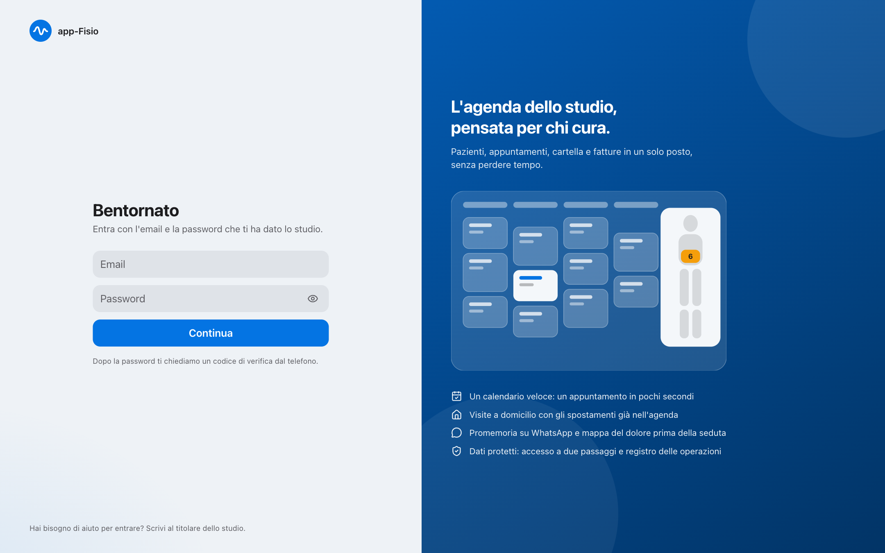
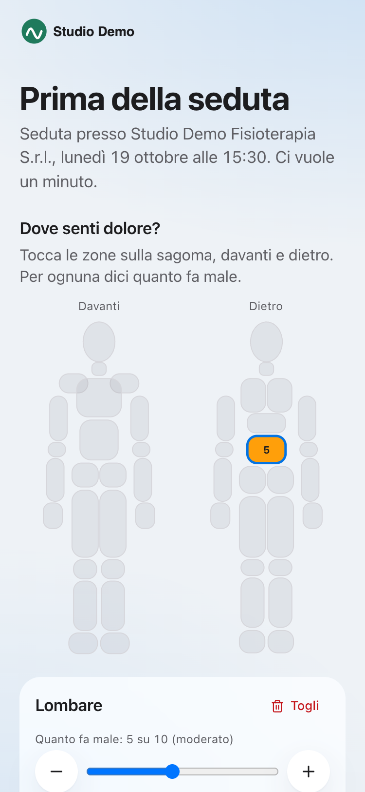
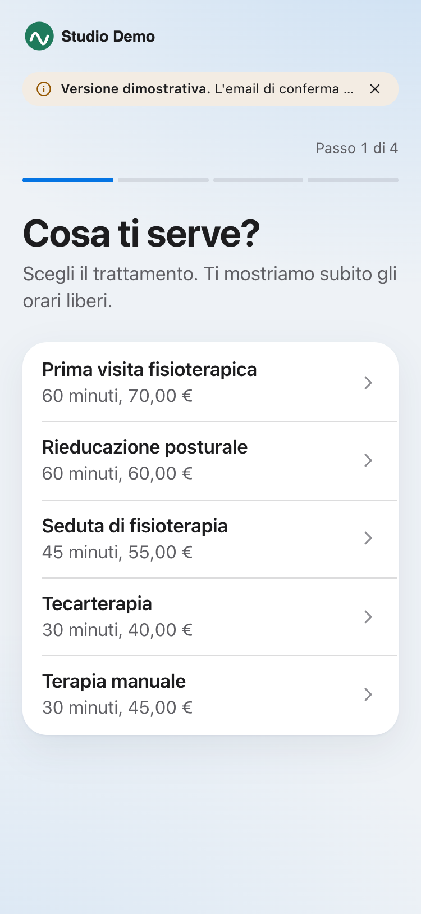

# app-Fisio

**Il gestionale per studi di fisioterapia, pensato per chi cura.** 
Agenda veloce · visite a domicilio · cartella leggera · mappa del dolore · WhatsApp · fatture e Tessera Sanitaria

*Prototipo funzionante, tema chiaro e scuro. Tutti i dati mostrati sono finti.*

**[Guida illustrata in PDF](app-Fisio-guida.pdf)**

> Questa è la **repository dimostrativa**: contiene solo schermate e guida. Il codice sorgente è in una repository privata.

## Perché

Un solo professionista, o uno studio con più terapisti, lascia il vecchio gestionale e ritrova in un unico posto agenda, pazienti, cartella,
prenotazione online, promemoria e fatture, con uno stile pulito e accessibile (WCAG 2.2 AA verificato in automatico su ogni schermata).

## Cosa fa

| | |
|---|---|
| **Calendario** | Giorno, settimana, mese. Trascini per spostare, crei un appuntamento in 4 gesti (clic, nome, Invio, Invio), ripeti una serie con controllo dei conflitti. |
| **Domicilio** | Luogo e indirizzo per appuntamento, spostamenti che occupano l'agenda, colori per luogo con casetta e bordo tratteggiato (mai solo il colore), supplemento in fattura. |
| **Pazienti e cartella leggera** | Avvertenze cliniche, note formattate con ricerca e allegati (modificabili entro 24 ore, poi integrazioni datate), pannello laterale che si apre subito dal calendario. |
| **Mappa del dolore** | Il paziente indica dove sente dolore da telefono, con un link protetto e monouso; il fisioterapista la vede prima della seduta, la corregge e confronta due date. |
| **Prenotazione e WhatsApp** | Prenotazione online da telefono, promemoria con Confermo e Sposta, lista d'attesa: il primo che risponde ottiene lo slot libero. |
| **Fatture** | PDF e fattura elettronica (SDI), nota di credito, bollo, invio delle spese sanitarie al Sistema Tessera Sanitaria, esportazione per il commercialista. |
| **Sicurezza e privacy** | Accesso a due passaggi, registro delle operazioni, credenziali cifrate, dati sanitari mai in WhatsApp o email, esportazione e cancellazione dei dati del paziente, backup cifrati. |

## Schermate

<table>
<tr>
<td width="50%"><b>Oggi</b> </td>
<td width="50%"><b>Scheda paziente al volo</b> </td>
</tr>
<tr>
<td><b>Creazione veloce</b> </td>
<td><b>Paziente e mappa del dolore</b> </td>
</tr>
<tr>
<td><b>Analisi</b> </td>
<td><b>Accesso</b> </td>
</tr>
</table>

Dal telefono, il paziente compila la mappa del dolore e prenota online:

&nbsp;&nbsp;

## Qualità

Oltre 400 test automatici (regole di business, isolamento tra studi, prestazioni con tetto di 10 query per pagina), flussi nel browser
con Playwright (compresa la prova "appuntamento in meno di 10 secondi e 4 gesti"), accessibilità con axe su tutte le schermate in chiaro e scuro,
ripristino verificato del backup.

## Stack

Next.js 15 · TypeScript · Prisma 6 + Postgres 16 · Tailwind 4 · Auth.js · Vitest · Playwright

> Prototipo dimostrativo: i servizi esterni (WhatsApp, SDI, Sistema TS, email) sono simulati. Le regole fiscali e di privacy sono assunzioni da validare con i professionisti.
